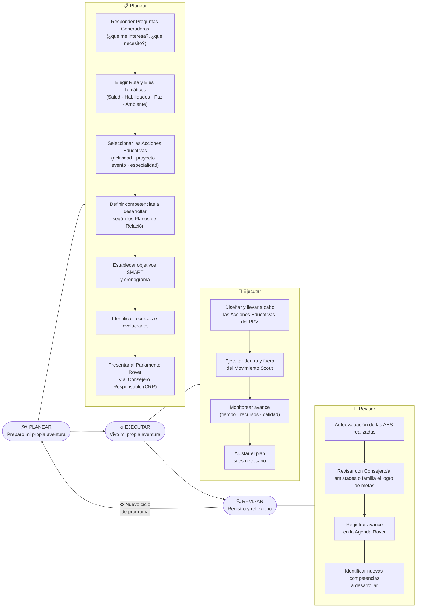

# ✏️ Metodología PER — Clan de Rovers

## Introducción

Ésta propuesta no sustituyen la documentación oficial, no nos hacemos responsables del mal uso.

La metodología PER en el mundo también se le conoce com o PDCA(Plan, Do, Check, Act)


## Tecnologías usadas

- [Claude Code](https://claude.com/product/claude-code) 

## Fuentes

- [Las Rutas del Rover — ASMAC 2024](https://drive.scouts.org.mx/s/qnisYDHz4TNbDpi?dir=/&editing=false&openfile=true)
- [Guía de Scouter de Clan de Rovers — ASMAC 2024](https://drive.scouts.org.mx/s/nPfaxYwRB4Ryiyw?dir=/&editing=false&openfile=true)

### Ciclo Personal de Programa | Jóvenes 18 a 21 años



> **Duración recomendada del Ciclo Personal de Programa:** 3, 4 o 6 meses máximo, para mantener objetivos SMART alcanzables.
> El ciclo es **personal e independiente** al Ciclo de Programa de la Sección.
```

#### Autora

- Yolanda Castillo 