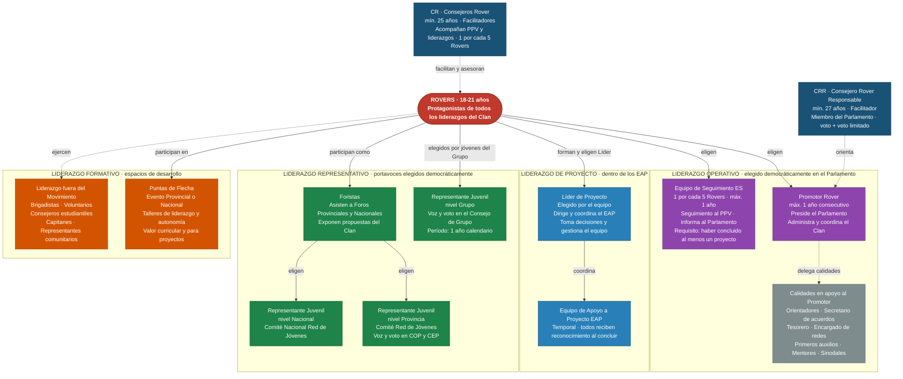

# ✏️ Liderazgo en el Clan de Rovers
---

## Tecnologías usadas

- [Claude Code](https://claude.com/product/claude-code) 

## Diagrama Tipos y roles de liderazgo en el Clan de Rovers ASMAC — operativo, de proyecto, representativo y formativo.

| Tipo | Rol | Elección / origen | Duración |
|---|---|---|---|
| **Operativo** | Promotor Rover | Proceso democrático en el Parlamento | Máx. 1 año consecutivo |
| **Operativo** | Equipo de Seguimiento (ES) | Elegido por el Parlamento; requisito: ≥1 proyecto concluido | Máx. 1 año; máx. 2 períodos en vida de Clan |
| **Operativo** | Calidades en apoyo al Promotor | Designadas/reconocidas por el Promotor según necesidad | Variable |
| **Proyecto** | Líder de Proyecto | Elegido por el Equipo de Apoyo a Proyecto (EAP) | Duración del proyecto |
| **Representativo** | Representante Juvenil nivel Grupo | Elegido por todos los jóvenes del Grupo | 1 año calendario |
| **Representativo** | Forista | Participa en Foros Provinciales y Nacionales | Por evento |
| **Representativo** | Representante Juvenil Provincia | Elegido en Foros Provinciales | Período del Comité |
| **Representativo** | Representante Juvenil Nacional | Elegido en Foros Nacionales | Período del Comité |
| **Formativo** | Puntas de Flecha | Evento Provincial o Nacional | Por evento |
| **Formativo** | Liderazgo fuera del Movimiento | Brigadistas, consejeros, capitanes, representantes comunitarios | Variable |
| **Adultos** | Consejero Rover Responsable (CRR) | Designado · mín. 27 años | Período del cargo |
| **Adultos** | Consejeros Rover (CR) | Designados · mín. 25 años | Período del cargo |

## Fuentes

- [Las Rutas del Rover — ASMAC 2024](https://drive.scouts.org.mx/s/qnisYDHz4TNbDpi?dir=/&editing=false&openfile=true)
- [Guía de Scouter de Clan de Rovers — ASMAC 2024](https://drive.scouts.org.mx/s/nPfaxYwRB4Ryiyw?dir=/&editing=false&openfile=true)

#### Autora

- Yolanda Castillo 