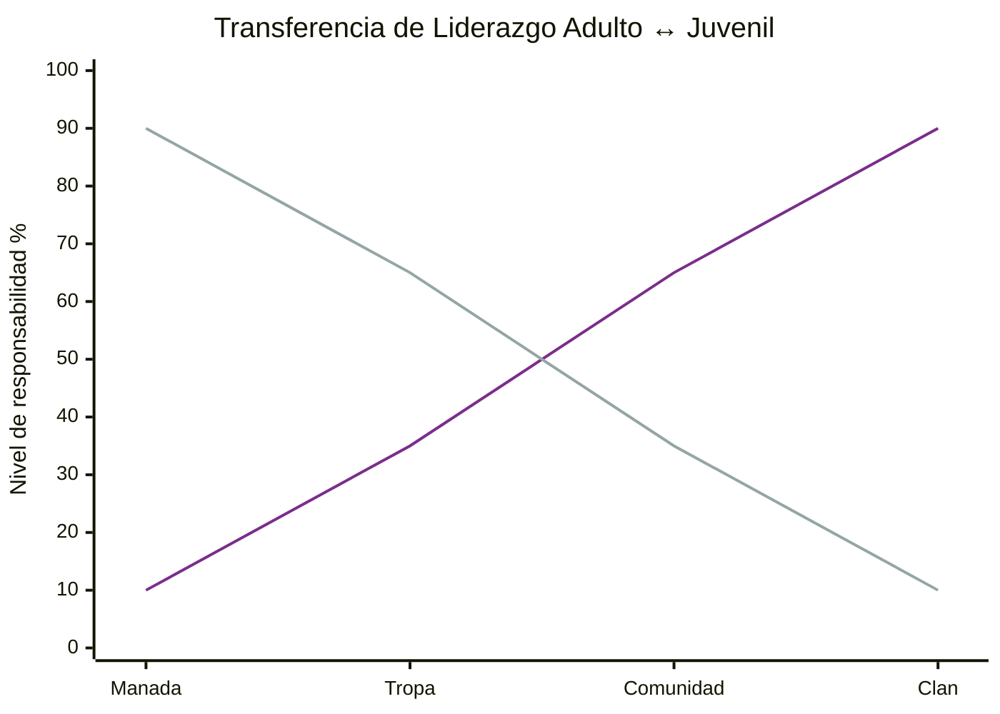
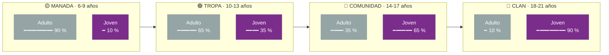
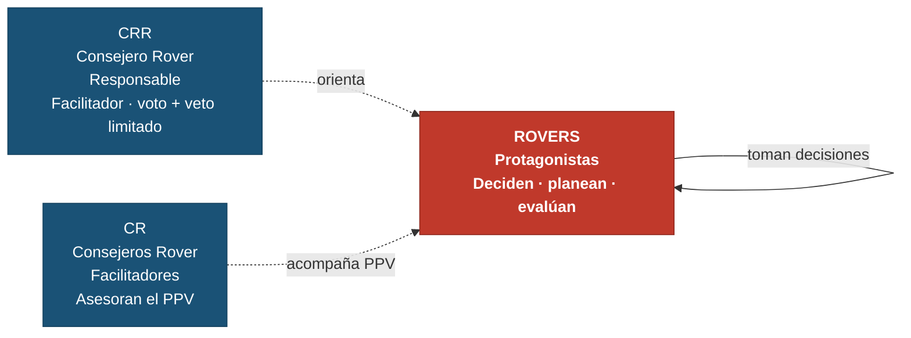

# ✏️ Transferencia de Liderazgo por Sección

---

# Transferencia de Liderazgo por Sección

A lo largo del Programa de Jóvenes, el protagonismo se transfiere progresivamente del adulto al joven. En la **Manada** el adulto lidera y el niño sigue; en el **Clan** el Rover decide y actúa, y el adulto solo orienta.

## Tecnologías usadas

- [Claude Code](https://claude.com/product/claude-code) 

## Curvas de transferencia

- Línea **morada** — Liderazgo Juvenil: crece con cada sección
- Línea **gris** — Liderazgo Adulto: decrece a medida que el joven madura y gana autonomía

## Balance por sección

## Rol del adulto en cada extremo

| Sección | Rol del adulto | Rol del joven |
|---|---|---|
| **Manada** | Dirige · planea · decide | Participa · sigue · aprende |
| **Tropa** | Guía · propone · acompaña | Comienza a planear · asume roles |
| **Comunidad** | Asesora · da retroalimentación | Lidera · organiza · decide con apoyo |
| **Clan** | Facilita · orienta · veto limitado | Protagonista total · planea · ejecuta · evalúa |

## En el Clan: el adulto como Facilitador

En el Clan, los Consejeros Rover (CRR y CR) adoptan el rol de **Facilitadores**, no de directores. El Movimiento Scout reconoce y busca impulsar el liderazgo juvenil de manera natural, generando los espacios para que los Rovers ejerzan su autonomía.

---
#### Autora

- Yolanda Castillo 