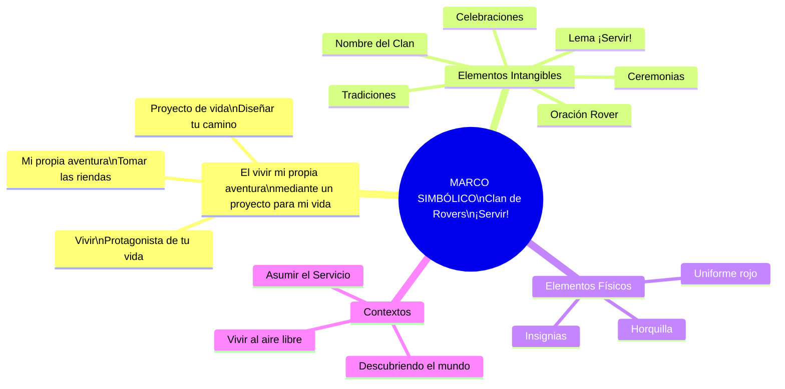
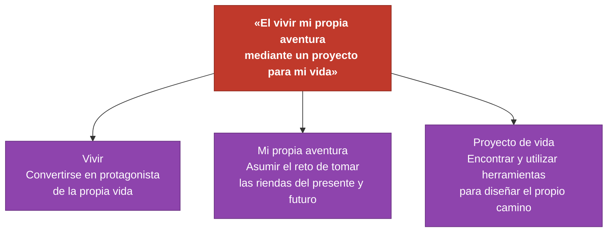
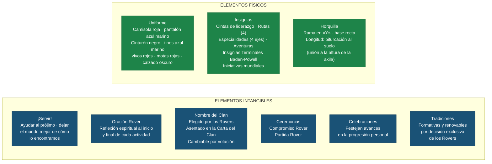
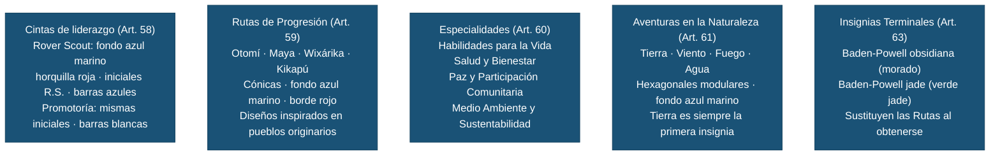
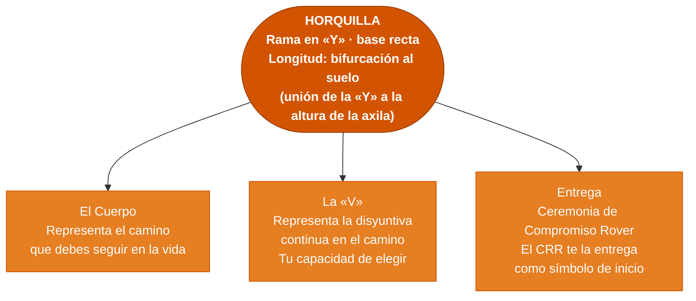
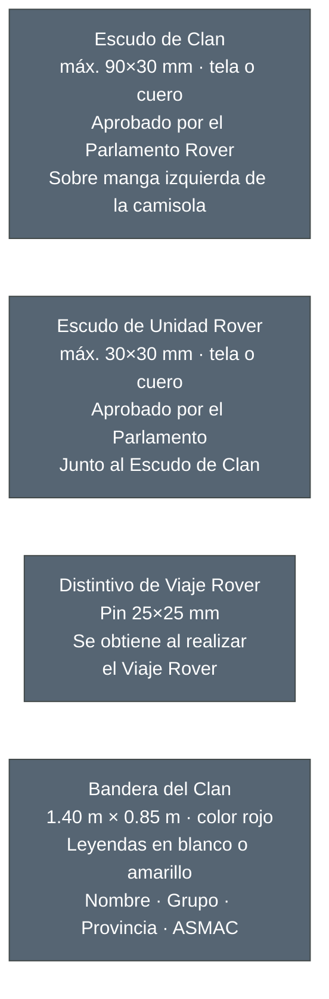
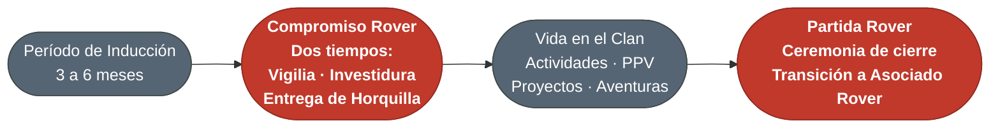
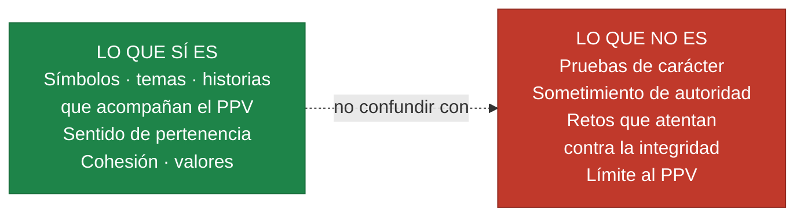

# Marco Simbólico del Clan de Rovers

> Fuentes: *Las Rutas del Rover* §2 (ASMAC, 2024) · *Guía de Scouter de Clan de Rovers* (DNME/CNAM, 2024) · *Manual del Uniforme ASMAC* (DEN, junio 2026)

Un **conjunto de símbolos, temas e historias** que desarrollan sentido de pertenencia, transmiten un mensaje educativo y estimulan la cohesión y la solidaridad dentro del Clan y del Movimiento Scout.

---

## Visión general

---

## Frase central y dinamismos

Estos tres dinamismos responden a las necesidades propias de los 18-21 años: independencia, identidad, sentido de pertenencia, autorrealización y aprehensión de valores.

---

## Elementos del Marco Simbólico

---

## Uniforme del Clan de Rovers

> *Manual del Uniforme ASMAC, Artículos 1–6 (junio 2026)*

| Prenda | Especificación |
|---|---|
| **Camisola** | **Roja** — Rovers y Consejeros Rovers; manga corta o larga |
| **Pantalón / short / falda** | Azul marino oficial |
| **Cinturón** | Negro liso; hebilla máx. 45 mm |
| **Calcetas** | Azul marino con **motas rojas** (sobresalen 25 mm de la calceta) |
| **Tines** | Azul marino con **vivos rojos** (sin motas) |
| **Calzado** | Oscuro, diseño funcional adecuado a la actividad |

---

## Insignias del Clan de Rovers

> *Manual del Uniforme ASMAC, Artículos 58–63 (junio 2026)*

---

## La Horquilla — símbolo del Rover

La Horquilla es una **rama con forma de «Y» y base recta** encontrada en el entorno natural y decorada por el propio Rover. Su longitud se determina de modo que la unión de la «Y» quede a la altura de la axila al apoyarla en el suelo; puede llevar regatón en la punta. Su uso está sujeto a lo que disponga el Parlamento Rover correspondiente.

---

## Elementos complementarios del Marco Simbólico

> *Manual del Uniforme ASMAC, Artículo 64 (junio 2026)*

Además de la Horquilla, el Art. 64 reconoce cuatro elementos que identifican físicamente al Clan:

---

## Ceremonias del Clan

---

## Lo que NO es el Marco Simbólico

:::warning Límites del Marco Simbólico
El Marco Simbólico **no puede**:
- Incluir **pruebas de carácter** o retos físicos/psicológicos para demostrar pertenencia
- Generar **sometimiento de autoridad** interna contrario a valores democráticos
- **Limitar el PPV** ni el desarrollo personal del Rover
- Ser **contrario a los valores** del Movimiento Scout ni a los ordenamientos de la ASMAC
- Permitir la permanencia de jóvenes **fuera de la edad reglamentaria** (18-21 años 6 meses)

Ninguna tradición o mística está por encima del Reglamento, el Código de Ética ni los documentos de la Sección.
:::

