# 💰 Procuración de Fondos y Vinculación Institucional

## Introducción

Esta propuesta no sustituye la documentación oficial, no nos hacemos responsables del mal uso.

La **Procuración de Fondos** en ASMAC es el conjunto de estrategias para obtener recursos que fortalezcan el Movimiento Scout en México — más de **52,000 miembros, 54 provincias, 800+ grupos en 264 ciudades**.

La **Vinculación Institucional** es la gestión de alianzas con gobierno, empresas, ONGs e instituciones educativas para ampliar el impacto scout.

Ambas áreas pertenecen a la **Dirección Nacional de Procuración de Fondos y Relaciones Públicas (DNPFYRP)**.

---

## Ecosistema completo

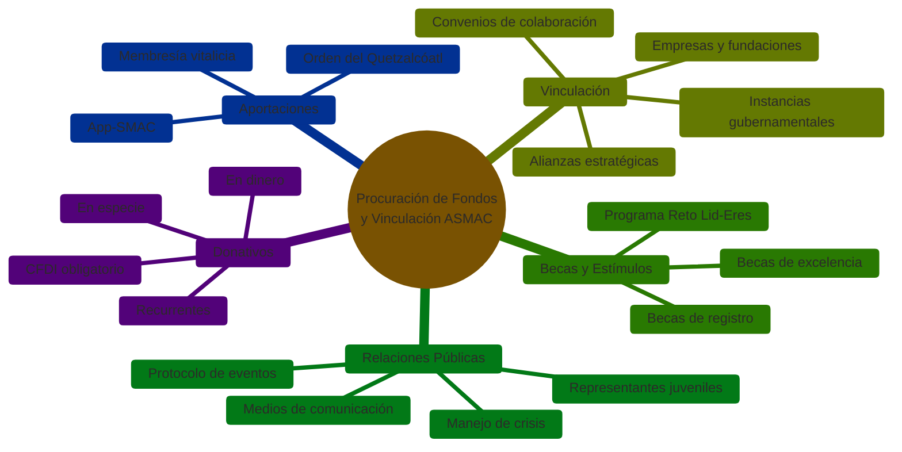

---

## Fuentes consultadas

- Política Nacional de Vinculación de la ASMAC, 2020 — Dirección Nacional de PF y RP
- Política Nacional de Procuración de Fondos, 2020 — Dirección Nacional de PF y RP
- Manual de Procuración de Fondos, 2020 — Dirección Nacional de PF y RP
- Manual de Relaciones Públicas y Protocolo, 2021 — Dirección Nacional de PF y RP

---

## Tipos de donativos

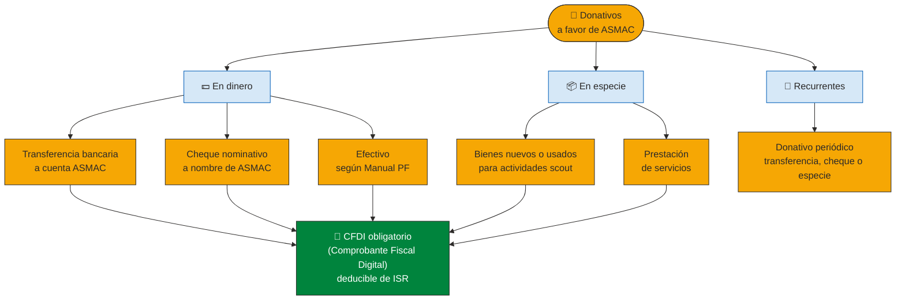

---

## Proceso para gestionar un donativo

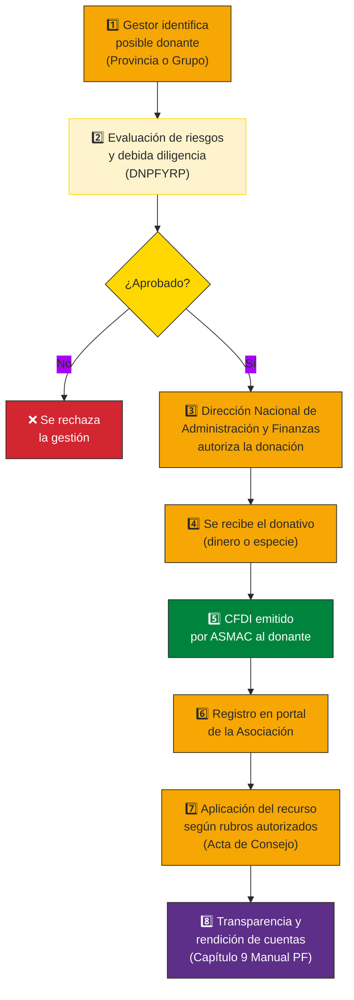

---

## Rubros en que se puede usar el recurso

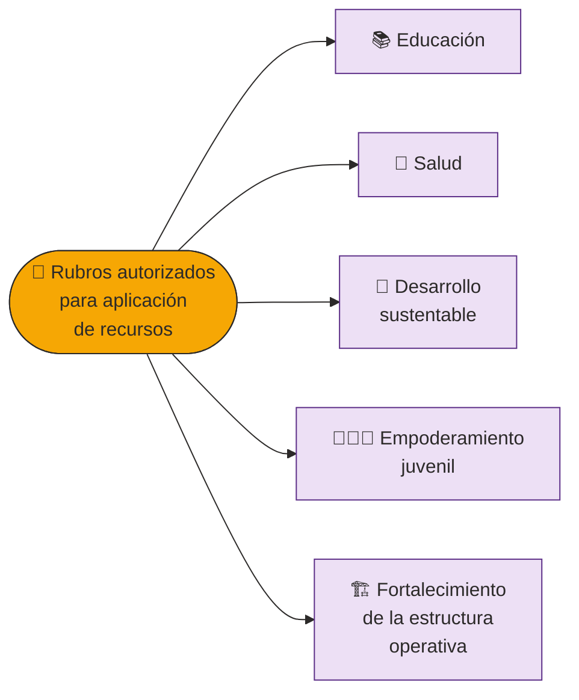

---

## Esquemas de aportaciones y membresía

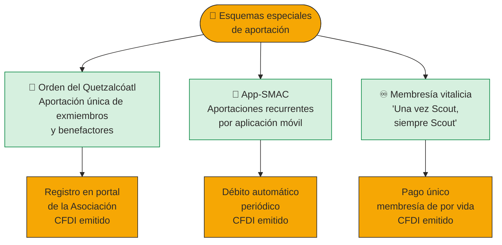

---

## Tipos de vinculación institucional

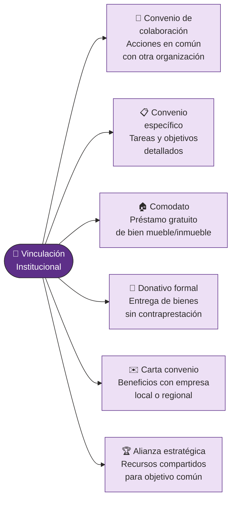

---

## Con quién puede vincularse ASMAC

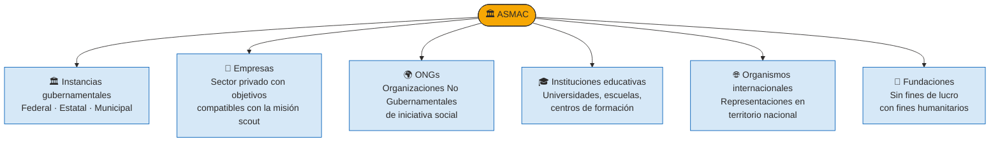

---

## Responsabilidades por nivel

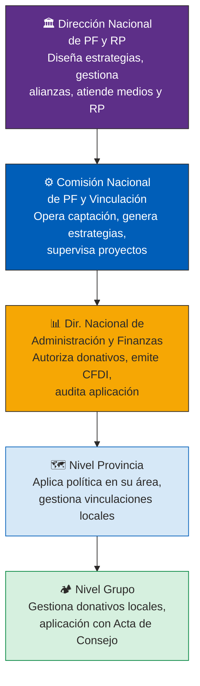

---

## Relaciones Públicas y Protocolo

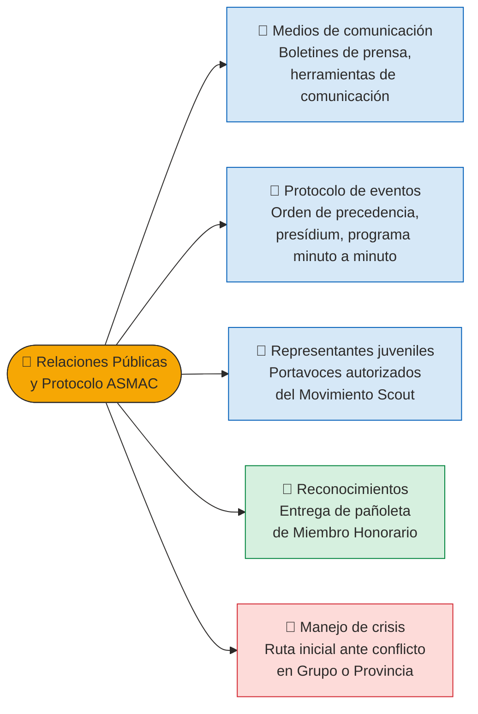

---

## Ruta de manejo de crisis ante medios

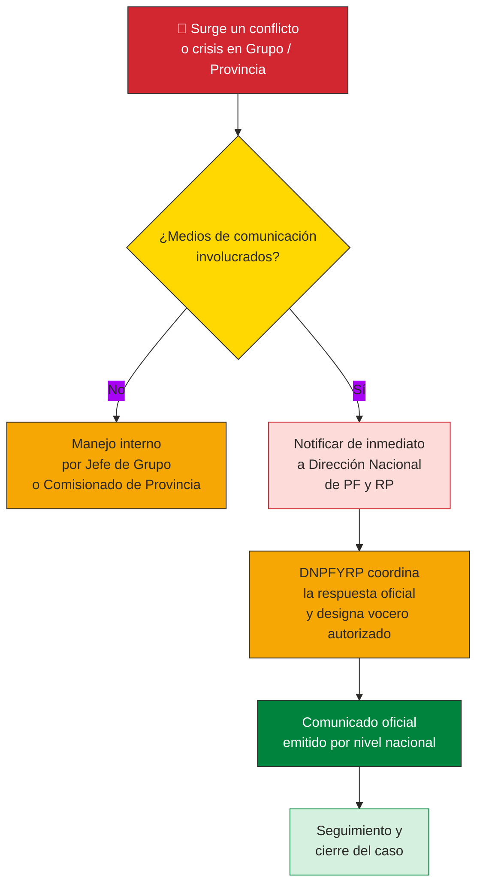

---

## Procuración de fondos en proyectos del Clan Rover

Los proyectos del Clan son la **columna vertebral del Proyecto Educativo Rover (PER)**. Muchos requieren recursos materiales, espaciales o económicos que van más allá de lo que el Clan puede autofinanciar. La procuración de fondos convierte una idea en realidad.

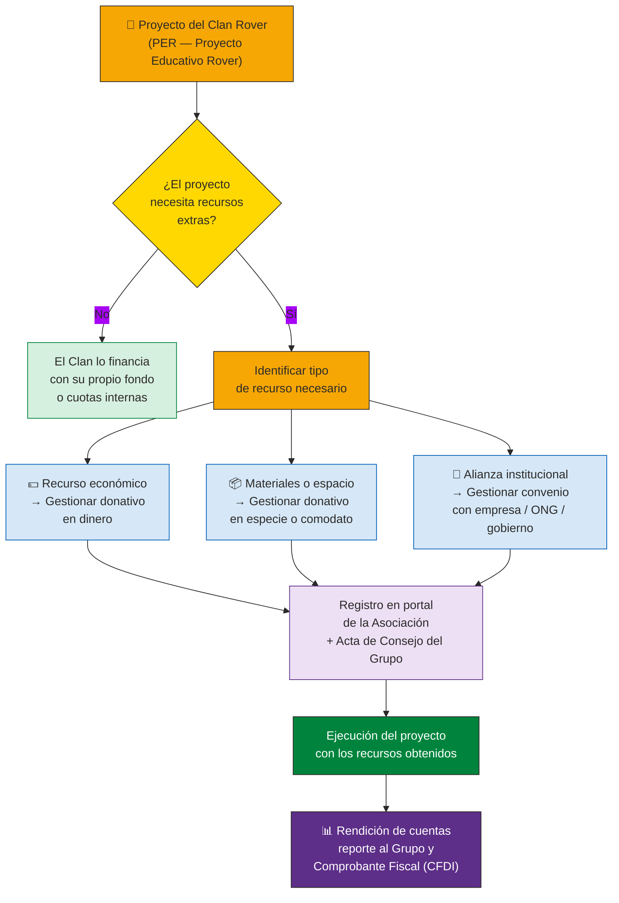

### ¿Por qué importa la procuración en un proyecto rover?

| Situación | Sin procuración | Con procuración |
|---|---|---|
| Proyecto de servicio comunitario | Limitado a lo que el Clan tiene | Puede escalar con donativo en especie (materiales, herramientas) |
| Campamento o expedición | Solo quien puede pagar participa | Becas de registro para rovers con necesidad económica |
| Proyecto de impacto social (ej. PaleoExplora) | Alcance local sin recursos | Alianza con institución educativa o empresa amplía el impacto |
| Formación especializada | El Clan absorbe el costo | Convenio con institución reduce o elimina el costo |

> **Regla clave:** Todo recurso gestionado a nombre de la ASMAC — sin importar el nivel — requiere **Acta de Consejo** y **CFDI**. El Clan no recibe donativos a título propio, sino a través del Grupo.

---

## Tecnologías usadas

- [Claude Code](https://claude.com/product/claude-code)
- [Mermaid](https://mermaid.js.org/)

### Autora

- Yolanda Castillo
