# 🛡️ Safe From Harm — A salvo del peligro

## Introducción

Esta propuesta no sustituye la documentación oficial, no nos hacemos responsables del mal uso.

**Safe From Harm** (en español: *A salvo del peligro*) es la política mundial de protección del Movimiento Scout Mundial (WOSM), aprobada en la **Conferencia Scout Mundial 2017**. En ASMAC es obligatoria para todos los adultos que trabajan con jóvenes.

Protege a **todas las personas entre 5 y 26 años** que participan en Scouting.

> En palabras simples: **es el compromiso del movimiento scout de que ningún joven sea dañado mientras participa en actividades scout — y que todos los adultos actúen cuando algo malo ocurre.**

---

## ¿Qué busca Safe From Harm?

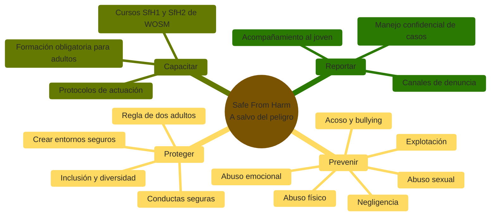

---

## ¿A quién protege y quién es responsable?

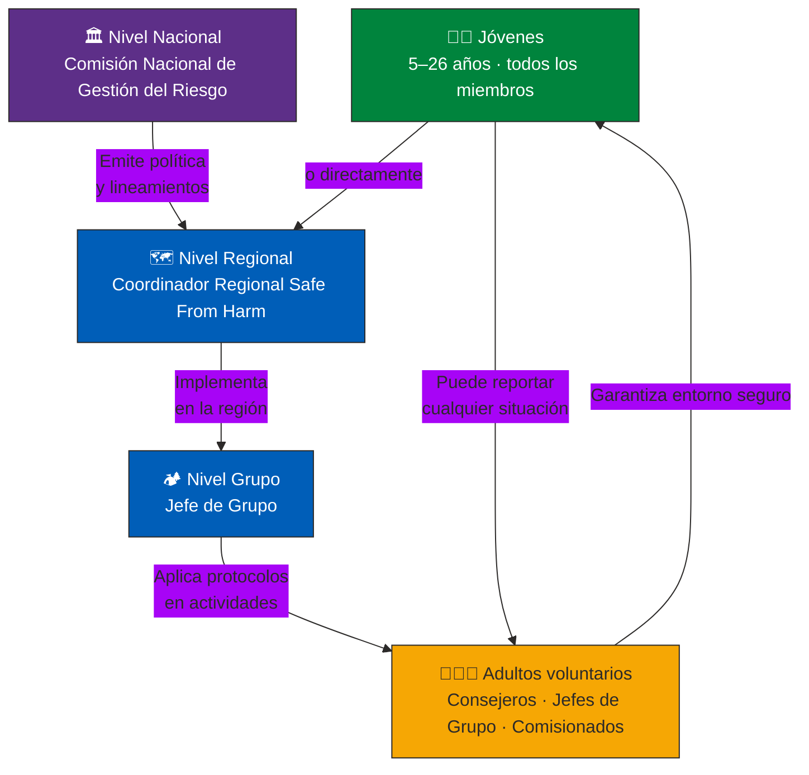

---

## Los 6 tipos de abuso que reconoce SFH

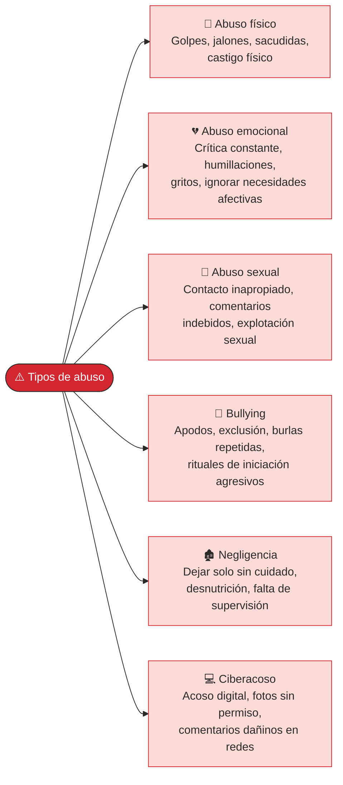

---

## ¿Cómo se siente un entorno seguro?

### Desde la perspectiva del joven

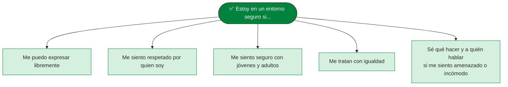

### Desde la perspectiva del adulto voluntario

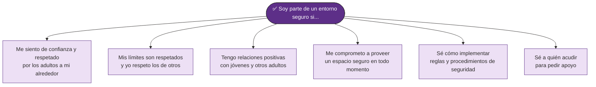

---

## Las 4 áreas que cubre

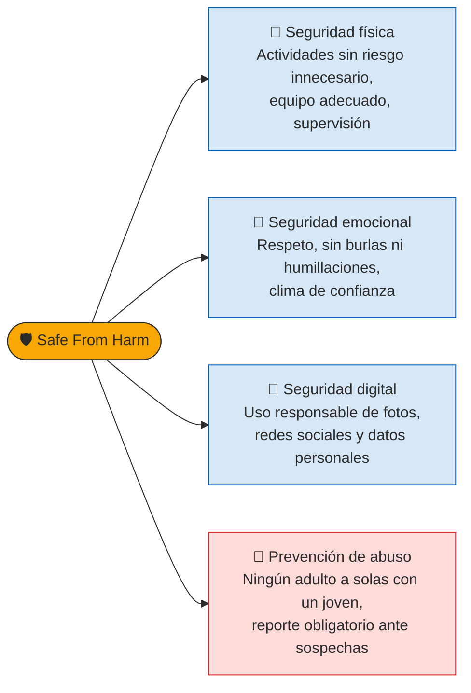

---

## ¿Qué debo hacer como adulto voluntario?

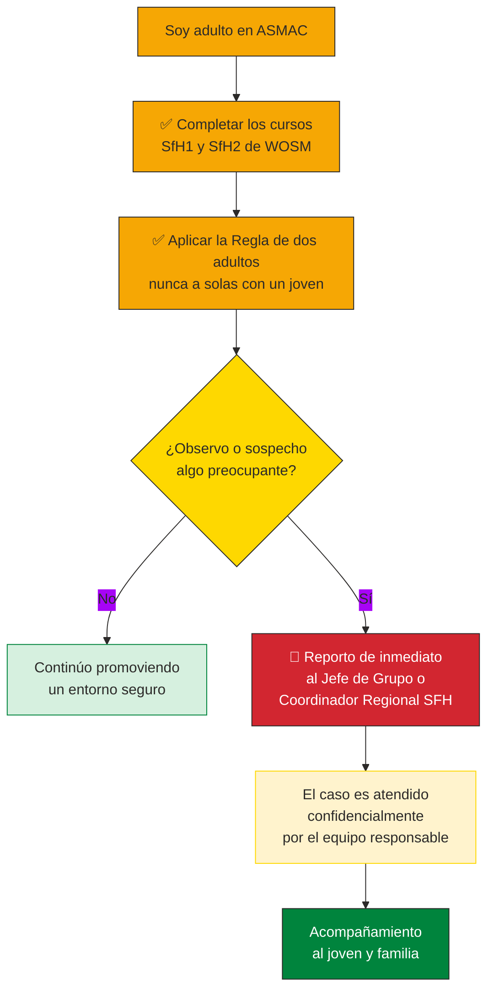

---

## Cuando un joven te busca para contarte algo

Estos pasos vienen directamente del curso SfH2 de WOSM:

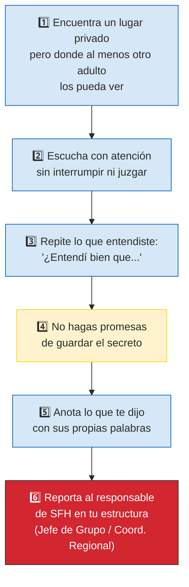

---

## Casos de estudio (del curso SfH2)

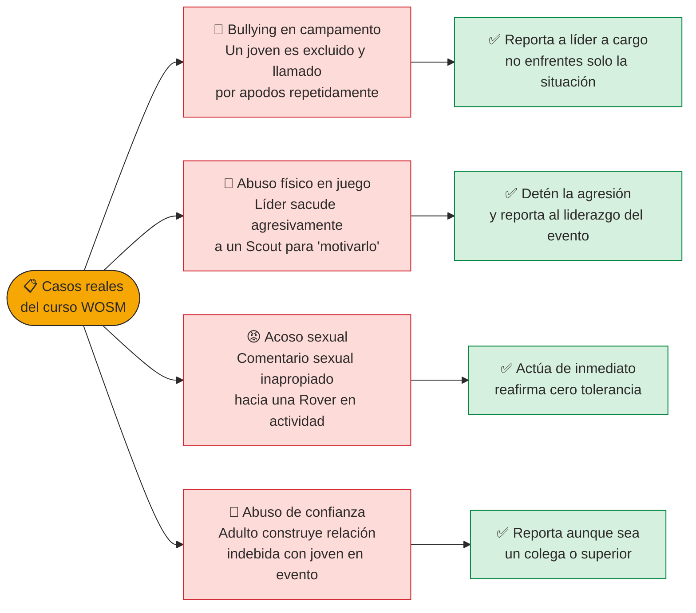

---

## ¿Por qué es importante en el Clan Rover?

Los rovers son **adultos jóvenes (18–21 años)** que a menudo apoyan actividades de ramas menores como lobatos o scouts. Esto los convierte en **adultos responsables** dentro del marco SFH:

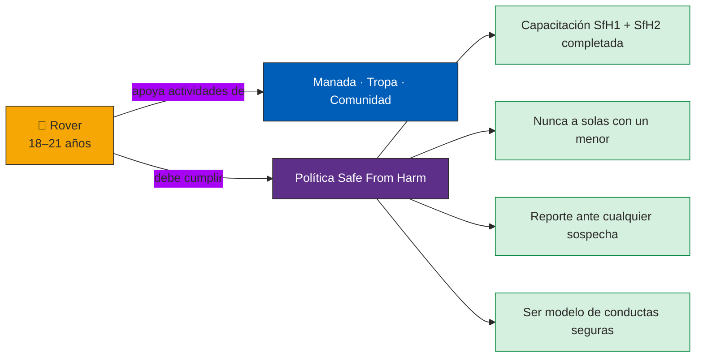

---

## Marco institucional SFH en ASMAC

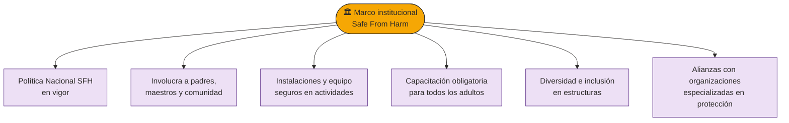

---

## Tecnologías usadas

- [Claude Code](https://claude.com/product/claude-code)
- [Mermaid](https://mermaid.js.org/)

### Autora

- Yolanda Castillo
