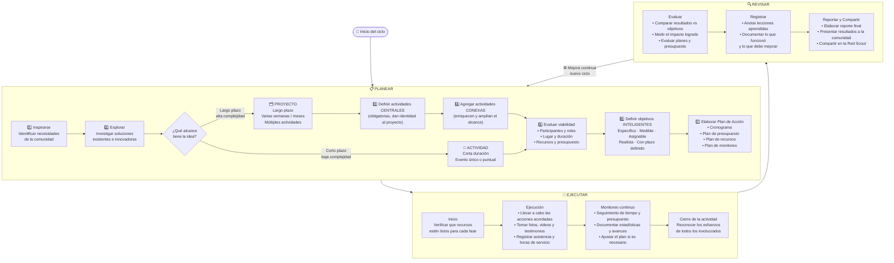

# ✏️ Proceso de Selección de Proyectos y Actividades — Ciclo PER

## Introducción

Ésta propuesta no sustituyen la documentación oficial, no nos hacemos responsables del mal uso.

## Tecnologías usadas

- [Claude Code](https://claude.com/product/claude-code) 

## Diagrama Selección de Proyectos en el Cliclo de Programa del Clan

##### Autora

    - Yolanda Castillo