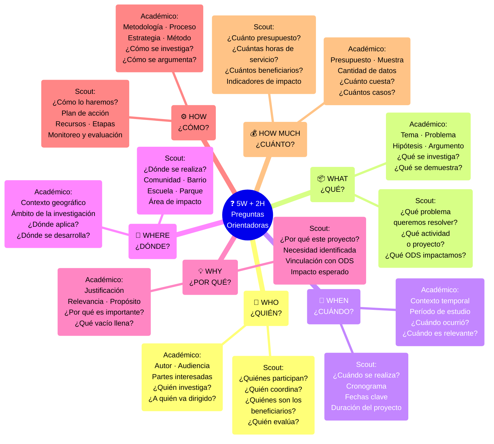
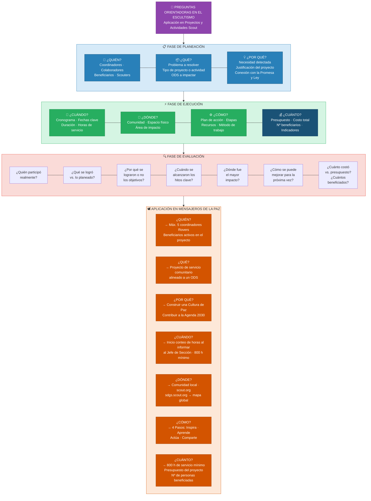

# 🔨 Framework 5W + 2H — Preguntas Orientadoras

## Introducción

Esta propuesta no sustituye la documentación oficial, no nos hacemos responsables del mal uso.

> En gestión de proyectos y mejora continua se conoce como **5W + 2H**.
> En el Movimiento Scout se aplica como **Preguntas Orientadoras** para planear, ejecutar y evaluar proyectos y actividades.

## Diagrama Preguntas Orientadoras

---

---

---

## Las 7 Preguntas Orientadoras — Referencia rápida

| Pregunta | Inglés | En gestión de proyectos | En Scouts (planeación) |
|---|---|---|---|
| **¿Quién?** | Who | Responsable, equipo, partes interesadas | Coordinadores, beneficiarios, scouters |
| **¿Qué?** | What | Objetivo, entregable, problema a resolver | Proyecto, actividad, ODS a impactar |
| **¿Cuándo?** | When | Fecha inicio/fin, cronograma, hitos | Cronograma, duración, horas de servicio |
| **¿Dónde?** | Where | Ubicación, ámbito geográfico o digital | Comunidad, espacio físico, alcance |
| **¿Por qué?** | Why | Justificación, causa raíz, propósito | Necesidad detectada, conexión con valores scout |
| **¿Cómo?** | How | Metodología, proceso, pasos de ejecución | Plan de acción, etapas, recursos, evaluación |
| **¿Cuánto?** | How Much | Presupuesto, costo, cantidad de recursos | Presupuesto, horas de servicio, beneficiarios |

---

## Fuentes

- [Las Rutas del Rover — ASMAC 2024](https://drive.scouts.org.mx/s/qnisYDHz4TNbDpi?dir=/&editing=false&openfile=true)
- [Guía de Scouter de Clan de Rovers — ASMAC 2024](https://drive.scouts.org.mx/s/nPfaxYwRB4Ryiyw?dir=/&editing=false&openfile=true)
- Moen, R. D., & Norman, C. L. (2010). *Circling Back: Clearing up myths about the Deming cycle and seeing how it keeps evolving.* Quality Progress, 43(11), 22–28. — Origen del 5W2H en la gestión de calidad (ciclo PDCA/PDSA).
- Ohno, T. (1988). *Toyota Production System: Beyond Large-Scale Production.* Productivity Press. — Fundamento del análisis de causa raíz con preguntas orientadoras.
- [5W2H](https://www.leanconstructionmexico.com.mx/post/5w2h-qu%C3%A9-significa-para-qu%C3%A9-sirve-c%C3%B3mo-aplicarla-y-algunos-ejemplos) qué significa, para qué sirve, cómo aplicarla y algunos ejemplos

#### Autora

- Yolanda Castillo
