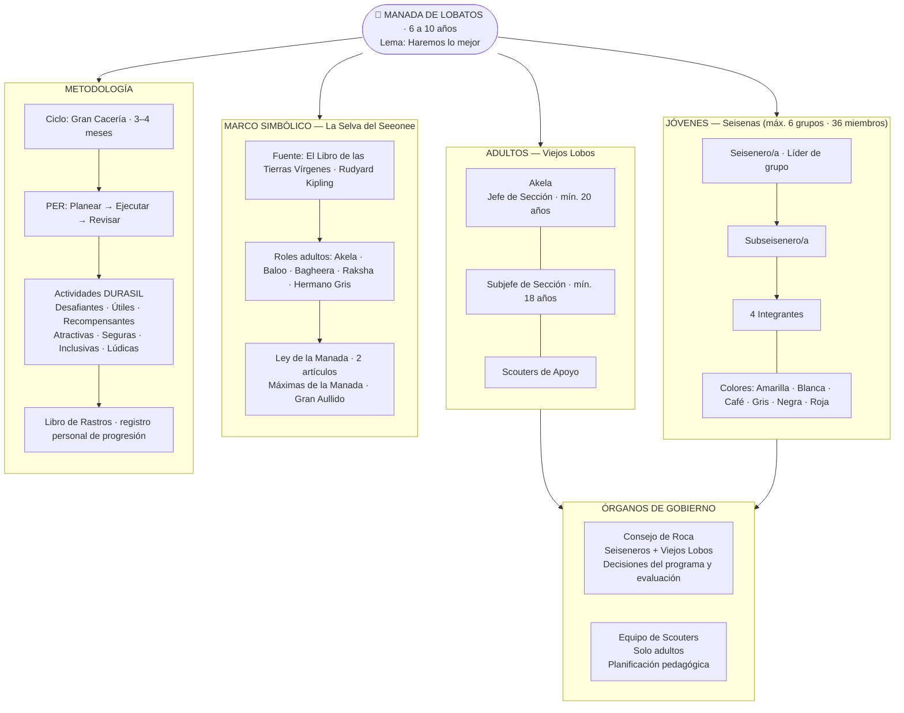

# ✏️ Diagrama 1: Cómo Funciona la Manada

## Introducción

Ésta propuesta no sustituyen la documentación oficial, no nos hacemos responsables del mal uso.

## Tecnologías usadas

- [Claude Code](https://claude.com/product/claude-code) 

## Diagrama Cómo funciona laManada de Lobatos

##### Autora

    - Yolanda Castillo