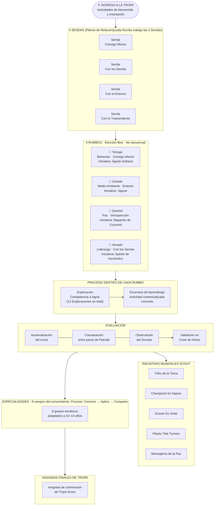

# ✏️ Diagrama 4: Progresión en la Tropa

## Introducción

Ésta propuesta no sustituyen la documentación oficial, no nos hacemos responsables del mal uso.

## Tecnologías usadas

- [Claude Code](https://claude.com/product/claude-code) 

## Diagrama Progresión en Tropa

##### Autora

    - Yolanda Castillo