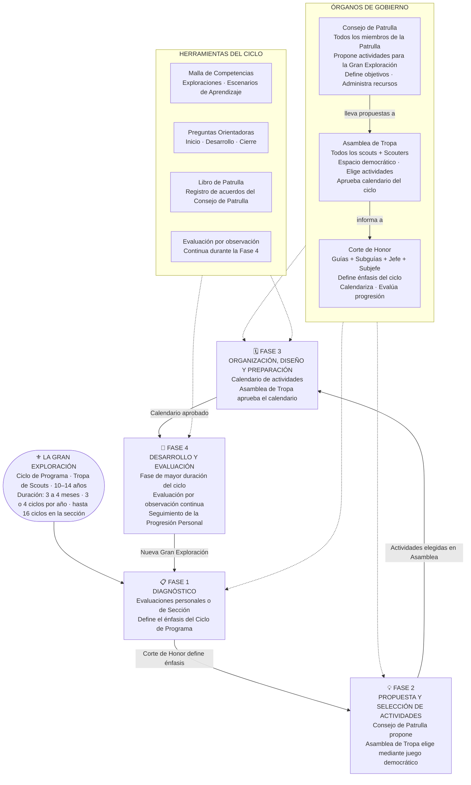

# ✏️ Ciclo de Programa — La Gran Exploración (Tropa)

## Introducción

Ésta propuesta no sustituyen la documentación oficial, no nos hacemos responsables del mal uso.

## Tecnologías usadas

- [Claude Code](https://claude.com/product/claude-code) 

## Diagrama Ciclo de Programa en Tropa

##### Autora

    - Yolanda Castillo