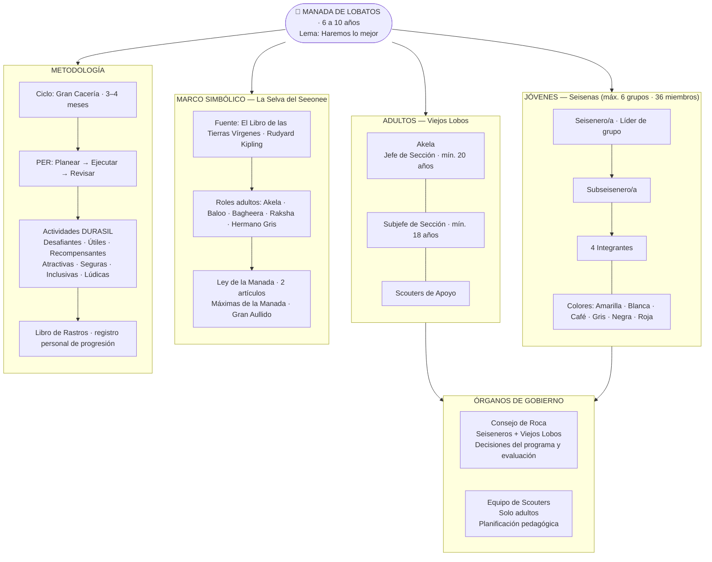
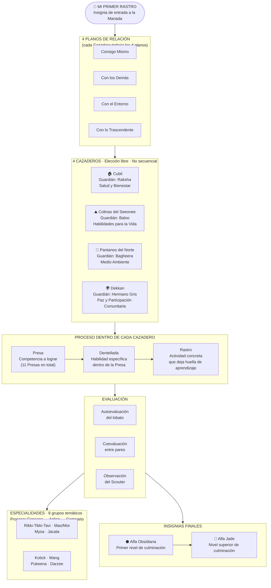
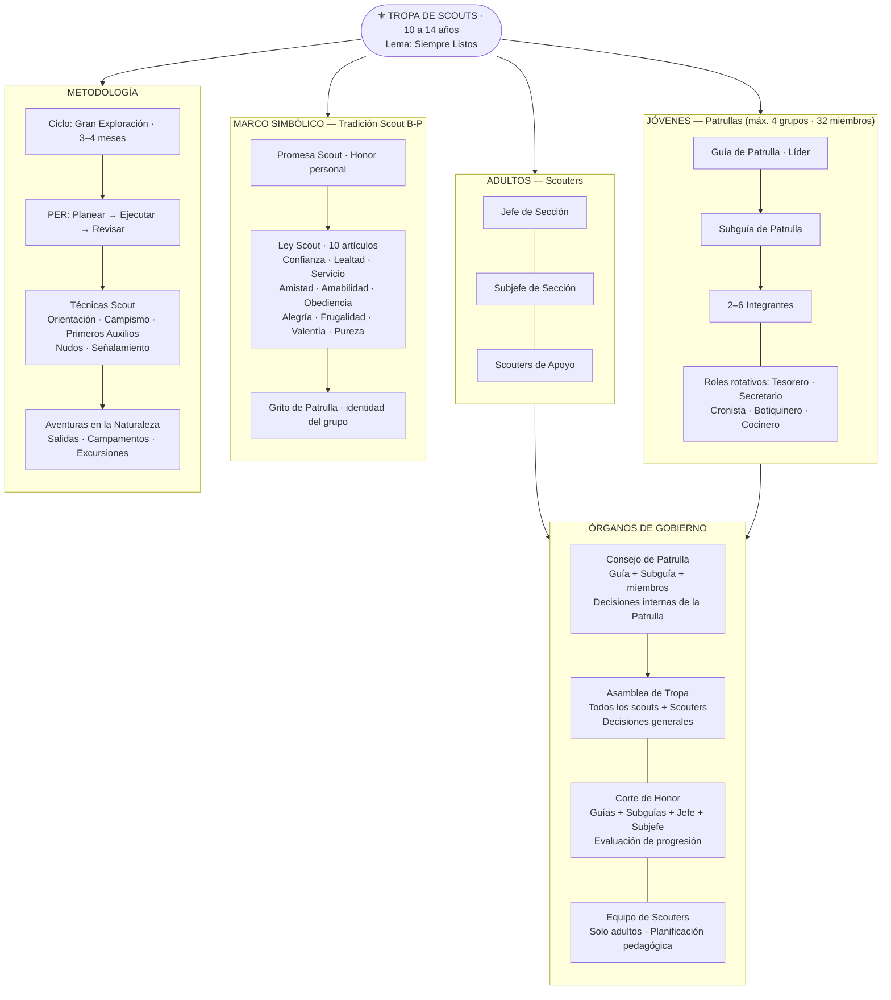
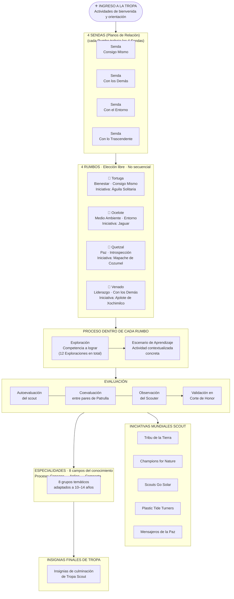
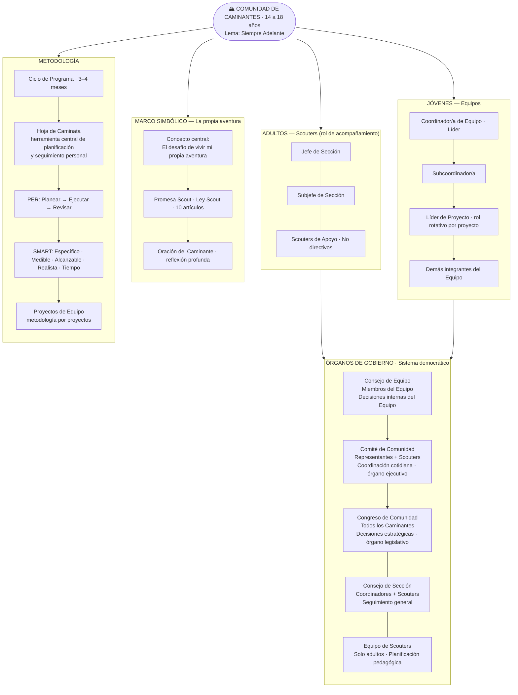
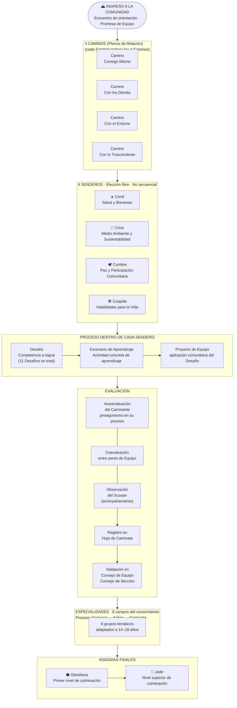

# ✏️ Diagramas Scout en Mermaid

---

## Introducción

Ésta propuesta no sustituyen la documentación oficial, no nos hacemos responsables del mal uso.

## Tecnologías usadas

- [Claude Code](https://claude.com/product/claude-code) 

## Diagrama 1: Cómo Funciona la Manada

---

## Diagrama 2: Progresión en la Manada

---

## Diagrama 3: Cómo Funciona la Tropa

---

## Diagrama 4: Progresión en la Tropa

---

## Diagrama 5: Cómo Funciona la Comunidad

---

## Diagrama 6: Progresión en la Comunidad

##### Autora

    - Yolanda Castillo
