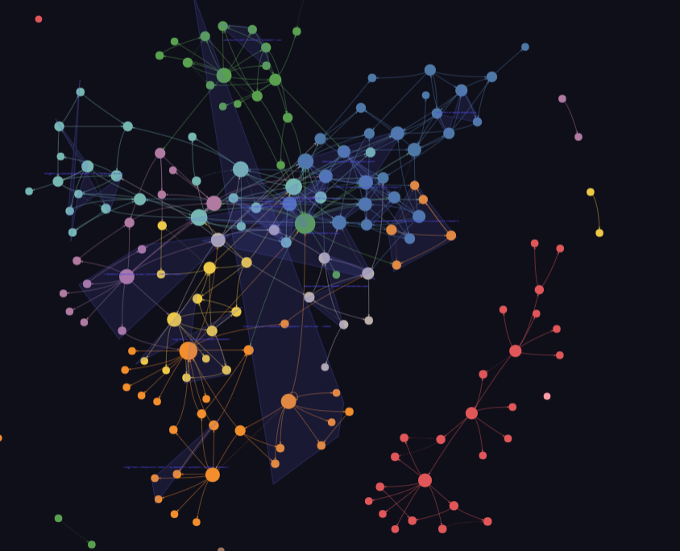
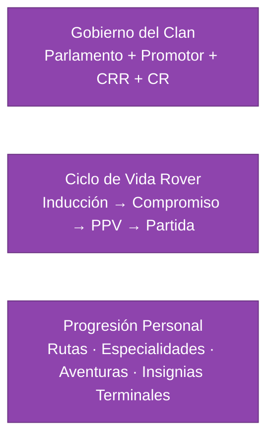
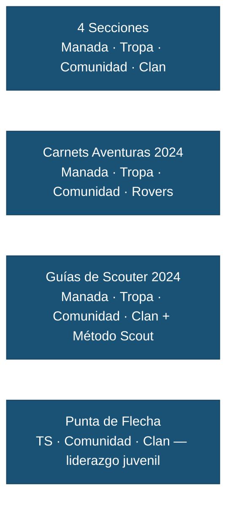
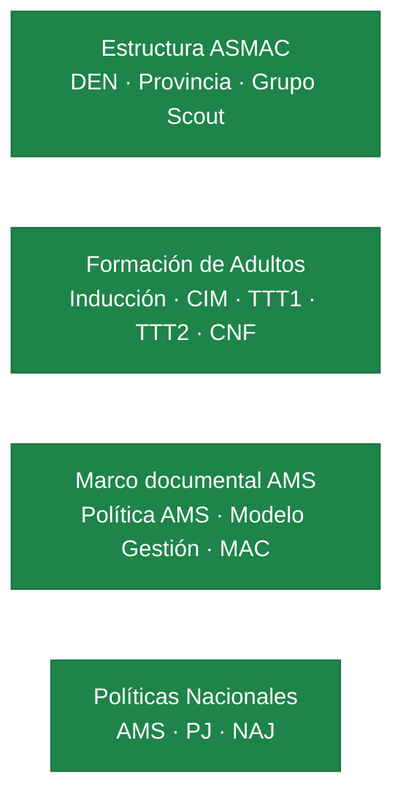
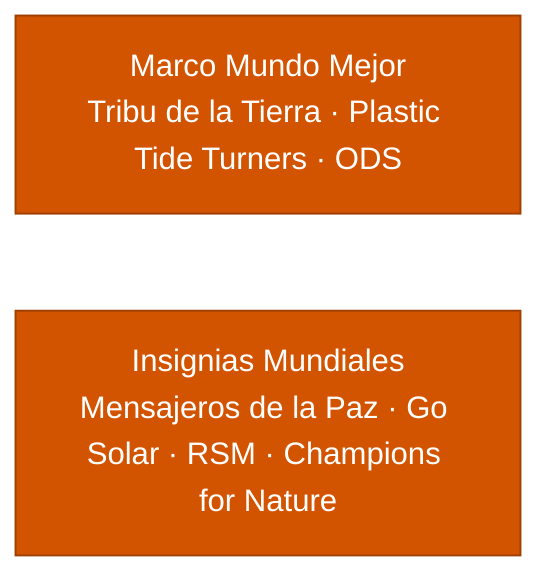

# 🔨 Mapa del Conocimiento — Corpus ASMAC

## Introducción

Ésta propuesta no sustituyen la documentación oficial, no nos hacemos responsables del mal uso.

Análisis de grafo del repositorio documental: **208 nodos · 368 aristas · 14 comunidades temáticas**. Las conexiones son 89% explícitas (EXTRACTED) y 10% inferidas (INFERRED, confianza promedio 0.88).

## Ténologías usadas:

- [Claude Code](https://claude.com/product/claude-code) para generar el código
- [Graphify](https://github.com/safishamsi/graphifyy)  sobre 59 documentos oficiales ASMAC · octubre 2026

---

## Comunidades temáticas

```mermaid
flowchart TB
    CLAN["Clan de Rovers<BR>18 conexiones — nodo puente central"]
    UNI["Manual del Uniforme 2026<BR>15 conexiones"]
    PJ["Programa de Jóvenes<BR>13 conexiones"]
    MET["Método Scout<BR>13 conexiones"]

    subgraph PROG["PROGRAMA DE JÓVENES"]
        MARC["Marco Simbólico Rover<BR>26 conceptos · símbolos · ceremonias"]
        ACT["Actividades y Proyectos<BR>25 conceptos · proyectos educativos"]
        AVEN["Aventuras en la Naturaleza<BR>5 carnets por sección"]
    end

    subgraph CLAN_SEC["CLAN DE ROVERS"]
        LID["Liderazgo del Clan<BR>20 conceptos · CRR · CR · ES · EAP"]
        AMS_C["Adultos en el Movimiento<BR>8 documentos · AMS · políticas"]
        FORM["Formación de Adultos<BR>13 cursos · CIM · TTT1 · TTT2"]
    end

    subgraph INST["INSTITUCIONAL"]
        EST["Estructura Institucional<BR>13 conceptos · Provincia · Grupo · DEN"]
        MUN["Programas Mundiales<BR>13 iniciativas · ODS · paz · naturaleza"]
        MIS["Misión Scout y Uniforme<BR>24 conceptos · uniforme · misión global"]
    end

    CLAN --> MARC
    CLAN --> LID
    CLAN --> ACT
    CLAN --> MIS
    CLAN --> AVEN
    UNI --> MARC
    UNI --> LID
    UNI --> MIS
    PJ --> PROG
    PJ --> INST
    MET --> LID
    MET --> FORM

    classDef bridge fill:#c0392b,stroke:#922b21,color:#fff,font-weight:bold
    classDef prog fill:#1a5276,stroke:#154360,color:#fff
    classDef clan fill:#8e44ad,stroke:#6c3483,color:#fff
    classDef inst fill:#1e8449,stroke:#196f3d,color:#fff

    class CLAN,UNI,PJ,MET bridge
    class MARC,ACT,AVEN prog
    class LID,AMS_C,FORM clan
    class EST,MUN,MIS inst
```

---

## Nodos centrales (God Nodes)

Los conceptos con mayor número de conexiones — son los ejes del conocimiento del corpus.

| # | Concepto | Aristas | Rol en el grafo |
|---|---|---|---|
| 1 | **Clan de Rovers** | 18 | Puente entre 5 comunidades; betweenness 0.157 |
| 2 | **Manual del Uniforme ASMAC 2026** | 15 | Conecta Marco Simbólico, Misión, Liderazgo |
| 3 | **Programa de Jóvenes** | 13 | Raíz del programa educativo de las 4 secciones |
| 4 | **Método Scout** | 13 | Base pedagógica transversal |
| 5 | **Declaración de Principios ASMAC 2020** | 12 | Marco axiológico del movimiento |
| 6 | **Guía de Scouter de Tropa 2024** | 12 | Documento educativo más referenciado de Tropa |
| 7 | **Estructura del Clan de Rovers (diagrama)** | 11 | Puente entre estructura institucional y programa |
| 8 | **Marco Simbólico del Clan de Rovers** | 11 | Núcleo de identidad de la Sección |
| 9 | **Manual de Operación Nivel Provincia** | 11 | Referencia institucional de Provincia |
| 10 | **Manual de Operación Nivel Grupo 2018** | 11 | Referencia institucional de Grupo |

---

## Grupos estructurales (Hyperedges)

Relaciones que vinculan 3 o más nodos en un patrón compartido — detectadas sobre el corpus completo.

### Clan de Rovers

### Programa de Jóvenes ASMAC

### Adultos en el Movimiento

### Programas Mundiales

---

## Conexiones sorprendentes

Relaciones detectadas entre documentos de comunidades distintas — puentes inesperados en el corpus.

| Origen | Relación | Destino | Fuente |
|---|---|---|---|
| Transferencia de Liderazgo Adulto-Juvenil | `rationale_for` | Clan de Rovers | Diagrama liderazgo → Manual Uniforme 2026 |
| Punta de Flecha (curso de liderazgo) | `references` | Clan de Rovers | Diagrama liderazgo → Manual Uniforme 2026 |
| Consejo de Grupo | `references` | Comité de Grupo | Diagrama estructura → Manual Nivel Grupo 2018 |
| Anexo 8 Captación y Selección de Adultos | `references` | Consejo de Grupo | Captación → Diagrama estructura |

:::info Puente más importante
**Clan de Rovers** (betweenness centrality 0.157) es el nodo que más comunidades conecta: Marco Simbólico, Actividades y Proyectos, Formación y Secciones, Programas Mundiales y Aventuras en la Naturaleza. Toda consulta sobre la Sección toca este nodo.
:::

---

## Documentos del corpus

| Comunidad | Documentos clave |
|---|---|
| **Marco Simbólico Rover** | *Las Rutas del Rover* · *Guía de Scouter Clan* · *Manual del Uniforme 2026* |
| **Actividades y Proyectos** | *ProyectosActividades.md* · *Desafío Caminante* · guías REME/OMMS |
| **Liderazgo del Clan** | *Las Rutas del Rover* §3 · *Guía de Scouter Clan* §3 |
| **Formación de Adultos** | *Modelo de Gestión de Adultos 2025* · *MAC 2025* · *Política AMS 2024* |
| **Estructura Institucional** | *Manual de Operación Nivel Grupo 2018* · *Manual Nivel Provincia 2019* |
| **Programas Mundiales** | Guías: Mensajeros de la Paz · Go Solar · RSM · Champions for Nature · Plastic Tide Turners |
| **Aventuras en la Naturaleza** | Carnets 2024: Manada · Tropa · Comunidad · Rovers |
| **Punta de Flecha** | Guías 2025: Tropa · Comunidad · Clan |

---

## Brechas de conocimiento

- **67 nodos aislados** con ≤ 1 conexión: variables de código de conversión de PDF (`fs`, `raw`, `pages`, `lines`). No representan brechas de contenido educativo.
- **2 relaciones INFERRED** sobre la *Declaración de Principios ASMAC 2020* pendientes de verificación manual.

#### Gráfica Intercactiva

Se puede explorar la [Gráfica Intercactiva](https://y-castillo.com/graphify-out/graph.html)

#### Código fuente

- **[⬇ Descargar carpeta de fuentes](https://github.com/conecta-clanes/my-website/tree/main/interface-fuentes/praphify-out/grapg.html)** 

##### Autora

- Yolanda Castillo 
