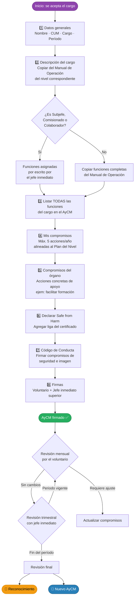

# Acuerdo y Compromiso Mutuo (AyCM)

El AyCM es el convenio formal entre el **adulto voluntario** y la **ASMAC** que establece:

- Las funciones del cargo que se acepta
- Los compromisos concretos del voluntario durante su gestión
- Los apoyos que el órgano correspondiente brindará

> **Vigencia:** mínimo 1 año, máximo 3 años.  
> **Revisión:** mensual (autoevaluación) + trimestral (con jefe inmediato).

---

## Diagrama de flujo — Llenado del AyCM

---

## Secciones del AyCM — qué va en cada una

### 1. Datos generales

Información básica de identificación. No puede faltar ningún campo.

| Campo | Qué escribir |
|-------|-------------|
| Nombre completo | Nombre oficial del voluntario |
| Grupo / Provincia | Nombre del grupo o provincia |
| CUM | Clave Única de Membresía (10 dígitos) |
| Cargo | Nombre exacto del cargo según el Manual de Operación |
| Período | Fecha inicial — Fecha final (ej. 01/01/2025 — 31/12/2026) |

### 2. Descripción del cargo

Copia textualmente la descripción de responsabilidades del cargo desde el **Manual de Operación del Nivel** (Grupo, Provincia o Nacional). Esta descripción responde a: *¿de qué soy responsable como titular de este cargo?*

### 3. Funciones del cargo

Lista completa de funciones indicadas en el Manual de Operación. Si el cargo es **Subjefe, Comisionado o colaborador**, las funciones deben ser asignadas **por escrito** por el jefe inmediato antes de este paso.

### 4. Mis compromisos como Scouter / Dirigente

Acciones concretas, medibles y fechadas que el voluntario realizará durante su gestión, alineadas a las metas del Plan del Nivel (Ruta hacia la Excelencia o Plan Estratégico).

:::tip Buena práctica
Incluye **máximo 5 acciones por año**. Si se cumplen antes, se pueden agregar nuevas metas semestrales o por ciclo de programa.
:::

La tabla de compromisos tiene esta estructura:

| No. | Acción | Fecha Programada | Fecha Real | Evaluación |
|-----|--------|-----------------|------------|------------|
| 1   |        |                 |            |            |

### 5. Compromisos del órgano correspondiente

Acciones **concretas** que el Grupo, Provincia o Nacional se compromete a brindar. Ejemplos válidos:
- "Facilitar la participación del voluntario en oportunidades de formación"
- "Crear el ambiente propicio de trabajo para las actividades del adulto"
- "Gestionar el registro de membresía de manera oportuna"

:::caution Importante
El AyCM **no** incluye la participación del voluntario en oportunidades de aprendizaje — eso va en el PPF.
:::

### 6. Certificado Safe from Harm

El voluntario declara haber completado el **"Curso de Formación a Salvo del Peligro para Voluntarios y profesionales de la OMMS"** e incluye la liga de validación de su certificado (`certificates.easygenerator.com`).

| Nivel | Enlace |
|-------|--------|
| SFH1 — Aprendizajes esenciales | [Tomar curso SFH1](https://learn.scout.org/resource/sfh-1-safe-harm-essential-learnings) |
| SFH2 | [Tomar curso SFH2](https://lms.scout.org/courses/show/214284) |
| SFH3 | [Tomar curso SFH3](https://lms.scout.org/courses/show/246857) |

### 7. Código de Conducta

El voluntario firma el Código de Conducta que cubre tres áreas:

- **Seguridad de la membresía** — proteger a niñas, niños, adolescentes y jóvenes
- **Conducta e imagen personal** — comportamiento en actividades y redes sociales
- **Relación con la ASMAC** — cumplir formación básica, no realizar colectas no autorizadas

### 8. Firmas

Firman al calce:
1. El voluntario (con nombre, cargo aceptado y fecha)
2. El jefe inmediato superior en representación de la ASMAC

---

## Revisión y seguimiento

| Momento | Responsable | Frecuencia |
|---------|-------------|------------|
| Autoevaluación | El voluntario | Mensual |
| Revisión con jefe inmediato | Voluntario + Jefe | Al menos cada 3 meses |
| Recompensas y renovación | Consejo del nivel | Al finalizar el período |

---

## Formato oficial para descargar

:::info Descarga el formato oficial de la ASMAC
[⬇ Descargar formato AyCM (PDF oficial)](https://drive.scouts.org.mx/s/Biix8ZYeTBCPj9m/download?_gl=1*o7ur5*_ga*NjU3NjI1NDY3LjE3NzMyNDM4OTI.*_ga_TMBXWP8KVW*czE3OTQyNjQ0OTUkbzMzJGcxJHQxNzk0MjY2MDI1JGo2MCRsMCRoMA..)
:::

---

## Siguiente paso

Una vez firmado el AyCM, el voluntario elabora su [Plan Personal de Formación (PPF)](./ppf.md).

Revisa también el [ejemplo completo de AyCM llenado](./aycm-ejemplo.md) para ver cómo queda en la práctica.

:::tip Recurso auxiliar
Para identificar las competencias que se requieren en cada función del cargo, consulta la [propuesta de Diccionario de Competencias](./diccionario-competencias.md). Incluye el marco de la ASMAC (CIM 2019) y referencias internacionales.
:::

---

## Tecnologías usadas

- [Claude Code](https://claude.com/product/claude-code)

##### Autora

- Yolanda Castillo
