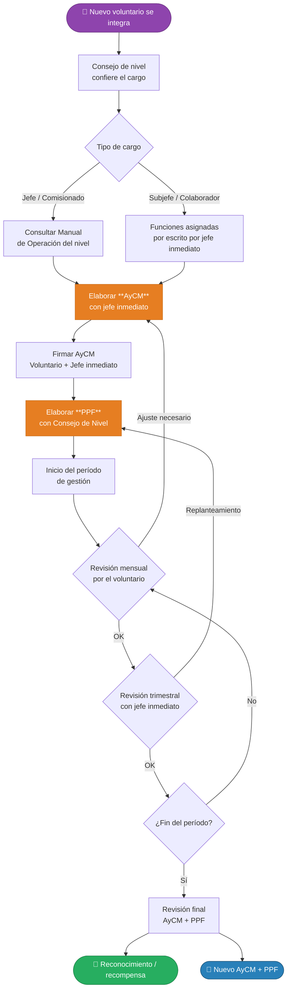

# PPF y AyCM — Adultos en el Movimiento Scout

La **Asociación de Scouts de México (ASMAC)** gestiona la participación de sus adultos voluntarios mediante dos documentos complementarios:

| Documento | Siglas | ¿Qué regula? |
|-----------|--------|--------------|
| Acuerdo y Compromiso Mutuo | **AyCM** | Las funciones, responsabilidades y compromisos entre el voluntario y la ASMAC |
| Plan Personal de Formación | **PPF** | Las oportunidades de aprendizaje que el voluntario tomará para desarrollar las competencias de su cargo |

> Ambos documentos son **dinámicos**: deben revisarse al menos cada 3 meses y renovarse dentro de los plazos establecidos.

---

## Visión general del proceso

El siguiente diagrama muestra cómo se relacionan ambos documentos a lo largo del ciclo de vida de un voluntario:

---

## Términos clave

| Término | Definición |
|---------|-----------|
| **Voluntario** | Adulto que se integra a la ASMAC como Scouter o Dirigente |
| **CUM** | Clave Única de Membresía |
| **Consejo de Nivel** | Órgano de toma de decisiones del Grupo, Provincia o Nacional |
| **Oportunidades de aprendizaje** | Lecturas, asesorías, cursos de formación básica o continua, cursos externos |
| **Insignia de Madera** | Certificación de formación de líderes adultos en la ASMAC |
| **Safe from Harm** | Curso obligatorio de la OMMS para mantener seguros a niñas, niños y jóvenes. Niveles: [SFH1](https://learn.scout.org/resource/sfh-1-safe-harm-essential-learnings) · [SFH2](https://lms.scout.org/courses/show/214284) · [SFH3](https://lms.scout.org/courses/show/246857) |

---

## Formatos oficiales para descargar

| Documento | Descarga |
|-----------|----------|
| Acuerdo y Compromiso Mutuo (AyCM) | [⬇ Descargar formato AyCM (PDF)](https://drive.scouts.org.mx/s/Biix8ZYeTBCPj9m/download?_gl=1*o7ur5*_ga*NjU3NjI1NDY3LjE3NzMyNDM4OTI.*_ga_TMBXWP8KVW*czE3OTQyNjQ0OTUkbzMzJGcxJHQxNzk0MjY2MDI1JGo2MCRsMCRoMA..) |
| Plan Personal de Formación (PPF) | [⬇ Descargar formato PPF (PDF)](https://drive.scouts.org.mx/s/P8P5qCAPDQ2cnHr/download?_gl=1*14z84g0*_ga*NjU3NjI1NDY3LjE3NzMyNDM4OTI.*_ga_TMBXWP8KVW*czE3OTQyNjQ0OTUkbzMzJGcxJHQxNzk0MjY2MDI1JGo2MCRsMCRoMA..) |

---

## Navegación de esta guía

- [Qué es el AyCM y cómo llenarlo](./aycm.md) — Proceso paso a paso con diagrama
- [Ejemplo completo de AyCM llenado](./aycm-ejemplo.md) — Caso real simulado
- [Qué es el PPF y cómo llenarlo](./ppf.md) — Proceso paso a paso con diagrama
- [Ejemplo completo de PPF llenado](./ppf-ejemplo.md) — Caso real simulado
- [Diccionario de Competencias](./diccionario-competencias.md) — Propuesta auxiliar para identificar competencias al elaborar el PPF y el AyCM

---

## Tecnologías usadas

- [Claude Code](https://claude.com/product/claude-code)

##### Autora

- Yolanda Castillo
