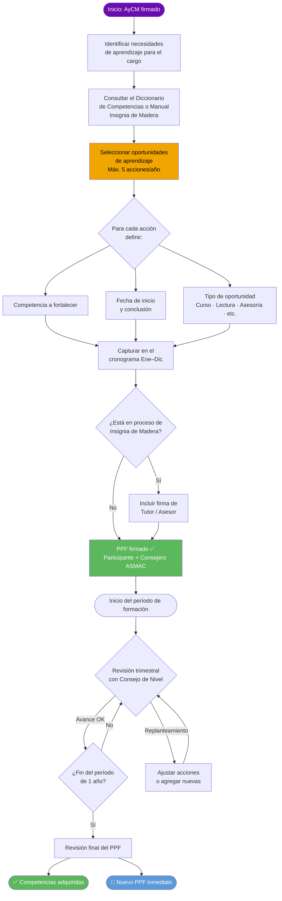

# Plan Personal de Formación (PPF)

El PPF es el documento con el que el voluntario **planea su propio aprendizaje**: identifica qué competencias necesita desarrollar para ejercer su cargo y define las oportunidades de formación en las que participará.

> **Vigencia:** máximo 1 año por período.  
> **Revisión:** al menos cada 3 meses con el Consejo de Nivel.  
> **Al concluir:** elaborar inmediatamente el siguiente PPF.

---

## Diagrama de flujo — Llenado del PPF

---

## Secciones del PPF — qué va en cada una

### 1. Datos generales

| Campo | Qué escribir |
|-------|-------------|
| Fecha | Día/mes/año en que se elabora el PPF |
| Nombre | Nombre completo del voluntario |
| Grupo / Provincia | Nombre del grupo y provincia |
| Cargo | Cargo que ocupa (igual que en el AyCM) |
| Calidad | Scouter / Dirigente / Formador / Director de Formación |

### 2. Acciones (oportunidades de aprendizaje)

Cada fila del PPF es una **oportunidad de aprendizaje** concreta. Pueden ser:

- Cursos de formación básica de la ASMAC (Curso de Inducción, Formación Básica por rama, Insignia de Madera)
- Cursos externos (primeros auxilios, gestión de proyectos, liderazgo)
- Lecturas guiadas de manuales o documentos oficiales
- Asesorías con un Comisionado de Adultos
- Talleres o webinars del movimiento scout

:::tip Regla de oro
Las acciones del PPF **deben estar ligadas a competencias** del Diccionario de Competencias de la ASMAC o del Manual de Implementación de Módulos del Curso Insignia de Madera.
:::

### 3. Competencia

Para cada acción, especifica la **competencia** que se fortalecerá. Ejemplos:

| Acción | Competencia |
|--------|-------------|
| Curso de Inducción al Movimiento Scout | Conocimiento del Movimiento Scout |
| Lectura del Manual de Operación de Grupo | Gestión administrativa del Grupo |
| Curso Safe from Harm | Seguridad y protección de la membresía |
| Taller de Primeros Auxilios | Gestión de emergencias en actividades |
| Formación Básica Rover | Conocimiento del programa de la rama Rover |

### 4. Fechas

| Campo | Qué registrar |
|-------|--------------|
| Fecha real de inicio | Mes/año en que el voluntario comenzó la acción |
| Fecha real de conclusión | Mes/año en que la completó |

### 5. Programa (cronograma)

La tabla del PPF incluye una columna por cada mes del año (Ene–Dic). Se marca el mes en que se planea realizar o completar cada acción. Esto permite visualizar la carga de formación a lo largo del año y detectar si está concentrada en pocos meses.

### 6. Cumplimiento y observaciones

Al revisar el PPF trimestralmente, se anota si la acción fue completada, si se pospuso, o cualquier observación relevante.

### 7. Firmas

| Firmante | Aplica cuando |
|----------|--------------|
| Participante (voluntario) | Siempre |
| Tutor / Asesor | Solo cuando el voluntario está en proceso de certificación de Insignia de Madera, Formador o Director de Formación |
| Comisionado ASMAC de Provincia o Comisión Nacional | Siempre |

---

## Consideraciones importantes

:::caution
- El PPF **solo** incluye oportunidades de aprendizaje, no actividades propias del cargo (esas van en el AyCM).
- Completar la formación básica es **obligatoria** según el Reglamento de la ASMAC.
- El PPF debe replantearse **de inmediato** al concluir el período vigente.
:::

---

## Revisión y seguimiento

| Momento | Responsable | Qué hacer |
|---------|-------------|-----------|
| Cada 3 meses | Voluntario + Consejo de Nivel | Revisar avances, ajustar si es necesario |
| Al concluir el año | Voluntario + Consejo de Nivel | Revisión final y elaboración del siguiente PPF |

---

## Formato oficial para descargar

:::info Descarga el formato oficial de la ASMAC
[⬇ Descargar formato PPF (PDF oficial)](https://drive.scouts.org.mx/s/P8P5qCAPDQ2cnHr/download?_gl=1*14z84g0*_ga*NjU3NjI1NDY3LjE3NzMyNDM4OTI.*_ga_TMBXWP8KVW*czE3OTQyNjQ0OTUkbzMzJGcxJHQxNzk0MjY2MDI1JGo2MCRsMCRoMA..)
:::

---

## Ejemplo práctico

Revisa el [ejemplo completo de PPF llenado](./ppf-ejemplo.md) para ver cómo se ve en la práctica con el caso de la CRR Ana López Ramírez.
